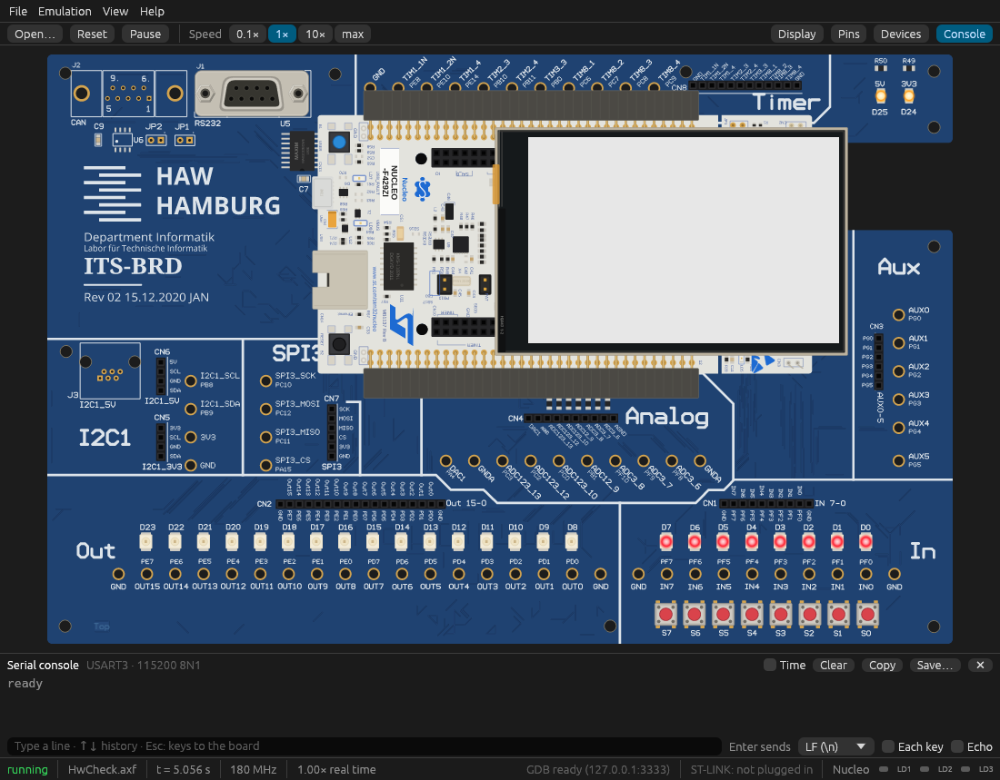

# ITS-Board Emulator

[](https://github.com/JanBdf/ITS-EMU/actions/workflows/ci.yml)
[](https://github.com/JanBdf/ITS-EMU/releases)
[%20%2F%20GPL--2.0%20(binaries)-blue)](#license)

A fast, hardware-validated Rust emulator for the **HAW Hamburg ITS-Board** (STM32 NUCLEO-F429ZI, ITS carrier board, and Waveshare 4" TFT touch shield). It executes unmodified `.axf` firmware built with the standard course toolchain ([ITS-BRD-VSC](https://github.com/Transport-Protocol/ITS-BRD-VSC) / Arm Compiler 6), including the STM32 HAL, `ITS_BRD_LIB`, and display drivers.

> [!NOTE]
> Independent, unofficial project — **not affiliated with, endorsed by, or supported by** HAW Hamburg, its *Labor für technische Informatik*, or the ITS-BRD-VSC project. See [Disclaimer](#disclaimer).



## Highlights

- **Unmodified firmware** — Drop in `.axf` binaries directly; no recompilation, stubs, or simulator-specific builds required.
- **Interactive GUI & Headless CLI** — Visual board with touch display, LEDs, buttons, pin inspector, serial console, and live hot-reload (`its-emu-gui`), plus a deterministic CLI (`its-emu`) for scripted inputs, screenshots, and automated testing.
- **Drop-in Debugging (VS Code, pyOCD, GDB)** — Built-in GDB server (`:3333`) plus a virtual ST-LINK/V2-1 (via USB/IP on Linux or a pyOCD plugin on macOS/Windows), so *CMSIS Load* and *STLink@pyOCD* work unchanged.
- **Hardware-Validated Timing & Peripherals** — Cortex-M4F cycle model, clock tree, flash timings, button contact bounce, and peripheral behavior calibrated and regression-tested against a real ITS-Board ([Validation](docs/validation.md)).
- **External Hardware & Co-Simulation** — Attach rotary encoders, DS18B20 / LM75 / X-NUCLEO-IKS01A3 sensors, a virtual Ethernet network, or a dual-core **Raspberry Pi Pico (RP2040)** running its own UF2 firmware.

## Installation

Pre-built packages are available on the [Releases](https://github.com/JanBdf/ITS-EMU/releases) page:

| Platform | Package | Install |
|---|---|---|
| **Debian / Ubuntu** (24.04+, Debian 13+, `amd64` / `arm64`) | `its-emu_<version>_<arch>.deb` | `sudo apt install ./its-emu_*.deb` |
| **Arch Linux** (`x86_64`) | `its-emu-<version>-x86_64.pkg.tar.zst` | `sudo pacman -U its-emu-*.pkg.tar.zst` |
| **macOS** (Apple Silicon / Intel) | `its-emu-<version>-macos-<arch>.dmg` | Drag *ITS-Board Emulator* to Applications |
| **Windows / Other** | CI artifacts or source | [Build from source](docs/development.md) or download recent [CI artifacts](https://github.com/JanBdf/ITS-EMU/actions/workflows/ci.yml) (kept 14 days) |

<details>
<summary><strong>Platform setup notes (macOS Gatekeeper, CLI symlink, VS Code ST-LINK)</strong></summary>

- **macOS Gatekeeper:** The app is ad-hoc signed, so macOS blocks the first launch. Allow it once under *System Settings → Privacy & Security → Open Anyway*.
- **macOS CLI:** Symlink the bundled CLI binary if needed:
  ```sh
  ln -s '/Applications/ITS-Board Emulator.app/Contents/MacOS/its-emu' /usr/local/bin/
  ```
- **VS Code / pyOCD (macOS & Windows):** On first launch, the GUI offers to register a virtual ST-LINK plugin for Arm's CMSIS Debugger extension so *CMSIS Load* and *STLink@pyOCD* work out of the box. On Linux, the `.deb` and Arch packages configure USB/IP automatically. See [Debugging](docs/debugging.md) for details.

</details>

## Quick Start

### Graphical Board (`its-emu-gui`)

```sh
its-emu-gui path/to/Program.axf
```

- Launch without arguments to run the built-in interactive tutorial.
- Press `0`–`7` for buttons S0–S7, click the display for touch input, drag-and-drop `.axf` files onto the window, and press `F1` for all shortcuts.

### Headless CLI (`its-emu`)

```sh
# Run 10 s of virtual time, press S7 at 2.5 s, send a serial line, and capture the screen
its-emu path/to/Program.axf --seconds 10 \
    --input "2.5:S7=1,2.6:S7=0,3:SERIAL=hello\n" \
    --screenshot screen.png
```

### Debugging with GDB

The GUI exposes a GDB server on `127.0.0.1:3333` by default (CLI: `--gdb`):

```sh
arm-none-eabi-gdb Program.axf -ex "target remote :3333"
(gdb) monitor load Program.axf
(gdb) tbreak main
(gdb) continue
```

See [Debugging](docs/debugging.md) for VS Code, pyOCD, and USB ST-LINK setup.

## Emulated Hardware

| Subsystem | Supported Features |
|---|---|
| **CPU & Core** | ARM Cortex-M4F (Thumb-2, FPU) via [Unicorn](https://www.unicorn-engine.org/); NVIC, SysTick, MPU, exceptions/faults, bit-banding, CoreSight debug architecture (FPB, DWT, ROM table), and a hardware-calibrated cycle model. |
| **Clocks, Power & Flash** | RCC clock tree (16 MHz HSI → 180 MHz PLL) with measured oscillator startup and PLL lock times; PWR; Flash interface with board-measured programming and erase timings. |
| **Timers & Analog** | TIM1–14 (up/down/center-aligned, PWM/output compare, input capture, encoder mode, slave modes, TIM1/8 repetition counter, complementary outputs with dead time & break); ADC1–3 (regular/injected, timer triggers); DAC (timer triggers, noise/triangle). |
| **Communication & DMA** | GPIO A–K, EXTI + SYSCFG; SPI1–6; I²C1–3 (master); USART1–6 + UART4/5/7/8 (USART3 wired as virtual COM port); DMA1/2 (direct/FIFO, double-buffer, peripheral requests, timer bursts); Ethernet MAC + LAN8742A PHY; USB OTG FS (device mode); IWDG, CRC, RNG. |
| **Board & Display** | ILI9486 480×320 TFT (SPI timing, vertical scrolling, backlight PWM, real panel tone response via `--ideal-colors` toggle), XPT2046 touch controller, LEDs OUT0–15, buttons S0–S7 (with measured contact bounce), INT0–5, Analog header, Nucleo LEDs & USER button. |
| **External Devices** | Rotary encoder, DS18B20 temperature sensors, I²C LM75 & X-NUCLEO-IKS01A3 sensor shield, virtual Ethernet network, and an emulated dual-core **Raspberry Pi Pico (RP2040)** (boot ROM, UF2 firmware, PIO0/1, DMA, PWM, ADC, USB CDC) running on its own thread. |
| **Host USB (Linux)** | Virtual Nucleo ST-LINK/V2-1 (debug + VCP), firmware USB OTG FS device (CN13), and Pico USB devices exported to the host OS over USB/IP. |

> **Current limitations:** I²C devices beyond LM75 and X-NUCLEO-IKS01A3, timer slave modes using ETR, and ADC triggers from CCx/EXTI are not yet implemented. See [PLAN.md](PLAN.md) for the full architecture, roadmap, and known deviations.

## Documentation

| Guide | Contents |
|---|---|
| [Usage](docs/usage.md) | GUI controls, CLI flags, scripted inputs, external devices, Pico co-simulation, virtual networking |
| [Debugging](docs/debugging.md) | GDB server, VS Code integration, USB/IP ST-LINK (Linux), and pyOCD plugin (macOS/Windows) |
| [Validation](docs/validation.md) | Hardware-in-the-loop benchmarks and comparison against a real ITS-Board |
| [Development](docs/development.md) | Building from source, workspace layout, CI, packaging (`.deb`, Arch, macOS), and releases |
| [Architecture & Roadmap](PLAN.md) | Crate architecture, known gaps, and performance notes |

## Disclaimer

This is an independent, private project and is **not affiliated with, endorsed by, or supported by** HAW Hamburg, its *Labor für technische Informatik*, or the ITS-BRD-VSC project. Those names are used solely to describe compatibility. Emulated behavior may differ from physical hardware, and course or exam requirements always refer to the real board. Course staff are not responsible for maintaining or supporting this emulator—please direct questions and bug reports to this repository's [issue tracker](https://github.com/JanBdf/ITS-EMU/issues).

All product names and trademarks belong to their respective owners.

## License

- **Source code:** [MIT License](LICENSE).
- **Pre-built binaries:** Statically link [Unicorn](https://www.unicorn-engine.org/) (GPL-2.0) and are therefore distributed under the **GPL-2.0** as a whole (Linux packages include both license texts). All other Rust dependencies use permissive licenses (MIT, Apache-2.0, BSD, Zlib, Unicode).
- **Test fixtures & fonts:** Firmware in `tests/fixtures/ac6` and `crates/itsboard/assets/fonts.bin` are derived from [ITS-BRD-VSC](https://github.com/Transport-Protocol/ITS-BRD-VSC) course material (BSD 2-Clause, © 2022 HAW Hamburg, Labor für technische Informatik), STM32CubeF4 HAL (BSD 3-Clause, STMicroelectronics), and CMSIS (Apache-2.0, Arm Limited).
