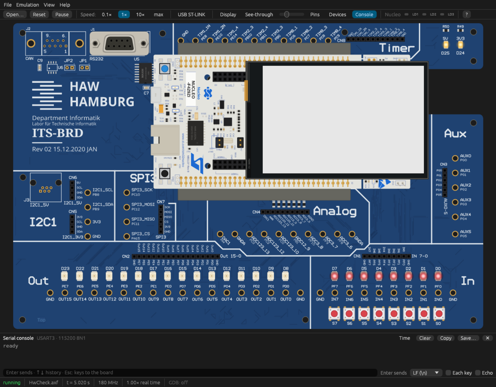

# ITS-Board Emulator

Emulator for the **HAW Hamburg ITS-Board** (NUCLEO-F429ZI with the ITS carrier
board and the Waveshare 4" TFT touch shield). It runs the unmodified `.axf`
images that the course toolchain ([ITS-BRD-VSC](https://github.com/Transport-Protocol/ITS-BRD-VSC),
Arm Compiler 6) builds, including the HAL, ITS_BRD_LIB and the display driver.



Status: work in progress — see [PLAN.md](PLAN.md).

> **Disclaimer:** An independent, private project, **not affiliated with,
> endorsed by or supported by** the HAW Hamburg, its Labor für technische
> Informatik or the ITS-BRD-VSC project; their names only describe what the
> emulator is compatible with. Results may differ from the hardware, and
> course or exam requirements always refer to the real board. Please do not
> contact the course staff about this emulator.

## Documentation

- [Usage](docs/usage.md) — the GUI, the command line, scripted inputs,
  external devices (encoder, temperature sensors, Raspberry Pi Pico), the
  network, platform notes
- [Debugging](docs/debugging.md) — the GDB server, VS Code, and the board's
  ST-LINK on USB (Linux: pyOCD, OpenOCD and terminal programs work unchanged)
- [Validation](docs/validation.md) — how the emulator is compared with the
  real board
- [Development](docs/development.md) — building, CI, packages and releases

## Installation

Packages are on the [Releases](https://github.com/JanBdf/ITS-EMU/releases) page:

| Platform | Package | Install |
|---|---|---|
| Arch Linux (x86_64) | `its-emu-<version>-x86_64.pkg.tar.zst` | `sudo pacman -U its-emu-*.pkg.tar.zst` |
| macOS (Apple silicon / Intel) | `its-emu-<version>-macos-arm64.dmg` / `-x86_64.dmg` | drag *ITS-Board Emulator* to Applications |

The macOS app is signed ad hoc, so macOS refuses the first start; allow it
once in *System Settings → Privacy & Security → Open Anyway*. The CLI is
inside the app:
`ln -s '/Applications/ITS-Board Emulator.app/Contents/MacOS/its-emu' /usr/local/bin/`.
The USB ST-LINK is Linux only; on macOS use the [GDB server](docs/debugging.md).

Other platforms: [build from source](docs/development.md), or take the Linux, Windows
and macOS binaries the CI keeps as workflow artifacts for 14 days.

## Quick start

```sh
its-emu-gui path/to/Program.axf        # graphical board

# headless: 10 s of virtual time, press S7 at 2.5 s, send a serial line,
# save the display
its-emu path/to/Program.axf --seconds 10 \
    --input "2.5:S7=1,2.6:S7=0,3:SERIAL=hello\n" --screenshot screen.png
```

In the GUI, keys `0`–`7` press S0–S7, clicking the display touches it,
firmware files can be dropped onto the window, and F1 lists all controls.
Everything else is in [Usage](docs/usage.md).

## What is emulated

| | |
|---|---|
| CPU | Cortex-M4F (Thumb-2, FPU) via [Unicorn](https://www.unicorn-engine.org/); NVIC, SysTick, exceptions and faults in Rust |
| Clock | RCC clock tree (16 MHz HSI → 180 MHz PLL) with the oscillators' start-up and the PLLs' lock time; virtual time in CPU cycles with a Cortex-M4 cycle model (loads, branches, divisions, exceptions, APB wait states) measured on the board |
| Peripherals | GPIO A–K, EXTI + SYSCFG, TIM1–14 (up/down/center-aligned, output compare/PWM on the pins, input capture, encoder mode, slave modes reset/gated/trigger/external clock from TI1/TI2 or another timer's TRGO, TIM1/8 repetition counter, complementary outputs with dead time, break, COM), ADC1–3 (regular and injected, timer TRGO triggers), DAC (timer triggers, noise/triangle), I²C1–3 (master; optional LM75, other addresses NACK), SPI1–6, USART1–6 + UART4/5/7/8 (USART3 connected), IWDG, CRC, RNG, DMA1/2 (direct/FIFO with packing, double buffer, all peripheral requests, timer bursts), Ethernet MAC + LAN8742A PHY, PWR, flash interface (program/erase with datasheet timing), bit-banding |
| Board | LEDs OUT0–15, buttons S0–S7 (with contact bounce, as on the board), INT0–5, Analog header (pin voltages, DAC1), Nucleo LEDs and USER button; on any pins: rotary encoder, DS18B20 sensors, a Raspberry Pi Pico running its own firmware; a virtual network on the Ethernet jack |
| Pico | RP2040 with both M0+ cores and the real boot ROM, firmware from UF2: clocks, resets, timer, SIO, PIO0/1, PWM, ADC, DMA, RTC, XIP flash, USB CDC serial as a pseudo terminal. Own thread |
| Display | ILI9486 480×320 TFT with SPI timing, vertical scrolling, XPT2046 touch, backlight PWM, the real panel's tone response (`--ideal-colors` turns it off) |
| Serial | Virtual COM port (USART3, `printf` / `stdin_getchar`) |
| Debugging | GDB server: breakpoints, single step, watchpoints, registers incl. FPU, memory, `monitor reset halt` |
| USB (Linux) | The Nucleo's ST-LINK/V2-1 over USB/IP for pyOCD and OpenOCD, plus its virtual COM port; behind it halting debug, FPB, DWT, ROM table and CoreSight IDs |

Not yet: I²C devices other than the LM75, timer slave modes with ETR, ADC
triggers from CCx and EXTI.

## License

The source code is [MIT](LICENSE) licensed.

The binaries link [Unicorn](https://www.unicorn-engine.org/) statically
(GPL-2.0), so they are distributed as a whole under the GPL-2.0; the Arch
package carries both texts (`/usr/share/licenses/its-emu`). Other Rust
dependencies are permissive (MIT, Apache-2.0, BSD, Zlib, Unicode).

The firmware in `tests/fixtures/ac6` and `crates/itsboard/assets/fonts.bin`
are built from [ITS-BRD-VSC](https://github.com/Transport-Protocol/ITS-BRD-VSC)
course material (BSD 2-Clause, Copyright (c) 2022, HAW Hamburg, Labor für
technische Informatik) with parts of the STM32CubeF4 HAL (STMicroelectronics,
BSD 3-Clause) and CMSIS (Arm Limited, Apache-2.0); see the READMEs there.

All product names and trademarks belong to their owners; their use implies
no affiliation or endorsement.
